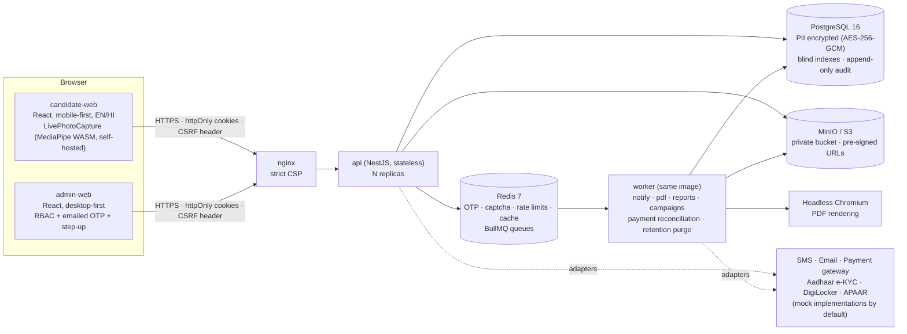
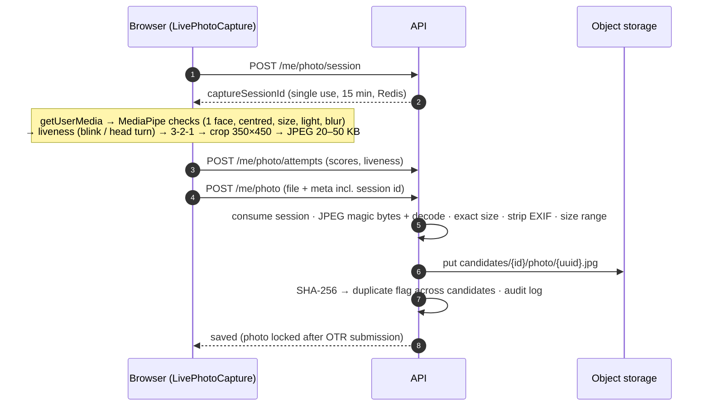
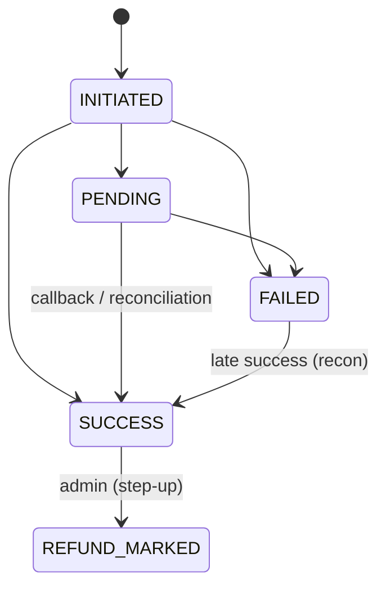

# VTL OTR: Architecture

## System view



### Request lifecycle
1. The `requestContext` middleware assigns a request ID and captures the IP and user agent (AsyncLocalStorage), so every audit row and log line can be correlated.
2. `helmet` applies the security headers: a strict CSP whose only script exception is `'wasm-unsafe-eval'` for MediaPipe, and `Permissions-Policy: camera=(self)`. `pino-http` writes structured logs with PII redacted. The CSRF double-submit check follows.
3. Guards: `CandidateGuard` and `AdminGuard`. The admin guard checks the OTP-verified session flag, roles (`@Roles`) and step-up code (`@StepUp`).
4. Controllers validate input with the **shared Zod schemas**. Services enforce business rules, also from `packages/shared` (eligibility, age relaxation, fees, OTR ID). Slow work is enqueued in BullMQ.

### Scaling for peak load (lakhs of registrations near deadlines)
- The API is stateless (JWT access tokens, refresh state in Postgres, everything else in Redis), so it scales horizontally behind a load balancer.
- OTP, captcha and rate-limit counters live in Redis with TTLs. SMS, email, PDFs, exports and campaigns are queued; workers scale independently, and per-queue concurrency shapes outbound SMS/email rates.
- Public exam lists and masters are cached in Redis. Every list endpoint uses keyset pagination. Indexes cover blind indexes, `otrId`, `dedupeKey`, photo `sha256`, `(examId, status)`, `(status, createdAt)` and a GIN index on name tokens.
- The candidate SPA is code-split per route. MediaPipe (about 140 KB JS plus WASM and the model) is loaded only on the photo step, so it does not affect landing-page LCP.

## Security model

| Concern | Implementation |
|---|---|
| Passwords | Argon2id (`@node-rs/argon2`, m=19 MiB, t=2), dummy verify for unknown users (timing) |
| Sessions | 15-minute access JWT + opaque rotating refresh tokens (SHA-256 hashed in DB); reuse revokes the family; httpOnly, SameSite=Strict, Secure in production |
| CSRF | Double-submit token (`vtl_csrf` cookie ↔ `X-CSRF-Token`); gateway callbacks are exempt but HMAC-verified |
| Staff sign-in | Password, then a 6-digit code emailed to the staff member (hashed in Redis, attempt-limited). The session stays partial until the code is verified. Sensitive actions need a fresh emailed code (step-up, valid 5 minutes). `DEMO_FIXED_OTP` fixes every OTP for demos and is refused in production unless `DEMO_MODE`. |
| PII at rest | AES-256-GCM per field (names, DOB, mobile, email, addresses, roll numbers, audit before/after, application snapshots) behind a `KeyProvider`; HMAC-SHA256 **blind indexes** for lookups (mobile, email, identity dedupe, name tokens) |
| Aadhaar | Never stored: only `XXXX-XXXX-1234` and a reference token |
| Files | Private bucket; only signed, short-lived URLs after an ownership or role check; magic-byte validation; PDFs only for certificates |
| Photos | Live-capture session token, JPEG decode, exact dimensions, size range, lossless EXIF strip, SHA-256, duplicate flagging, retake limit, lock after submission |
| Abuse | Self-hosted captcha, Redis rate limits (OTP, login, registration, tickets), account lockout, generic auth errors (no enumeration) |
| Audit | Every candidate and admin action: actor, IP, user agent, request ID, encrypted before/after; **append-only enforced by a Postgres trigger** |
| Logging | Pino JSON with a redaction list, no request bodies, no PII in URLs |
| Payments | HMAC signature check, amount match, idempotency key per (source, txn, status, gateway ref), explicit state machine, reconciliation job |
| Admit-card QR | Ed25519-signed compact token (exam, roll number, OTR ID, application number, photo hash prefix); public key published for offline verification |

## Data model

```mermaid
erDiagram
  Candidate ||--|| CandidateProfile : has
  Candidate ||--o{ Education : has
  Candidate ||--o{ Document : uploads
  Candidate ||--o{ MediaAsset : "photo / signature"
  Candidate ||--o{ PhotoAttempt : "capture attempts"
  Candidate ||--o{ Consent : grants
  Candidate ||--o{ CorrectionRequest : raises
  Candidate ||--o{ Application : submits
  Candidate ||--o{ HelpdeskTicket : raises
  Candidate ||--o{ Notification : receives
  HelpdeskTicket ||--o{ TicketMessage : contains
  Exam ||--o{ Post : offers
  Exam ||--o{ FeeRule : "fee matrix"
  Exam ||--o{ ExamCentreCity : "centre cities"
  ExamCentreCity ||--o{ ExamCentre : contains
  Exam ||--o{ Application : receives
  Application ||--o{ ApplicationEvent : timeline
  Application ||--o{ Payment : "paid by"
  Payment ||--o{ PaymentEvent : "callbacks / recon"
  Application ||--o| AdmitCard : gets
  AdmitCard }o--o| ExamCentre : "allocated to"
  Application ||--o| Result : has
  State ||--o{ District : contains

  Candidate {
    uuid id PK
    string otrId UK "VTL-OTR-YYYY-NNNNNNNC"
    enum status "DRAFT | SUBMITTED | BLOCKED"
    string mobileEnc "AES-GCM"
    string mobileIdx UK "HMAC blind index"
    string emailEnc
    string emailIdx UK
    string passwordHash "argon2id"
    string dedupeKey "HMAC(name+DOB+father)"
    string[] nameTokens "GIN"
  }
  CandidateProfile {
    uuid candidateId PK
    string fullNameEnc
    string dobEnc
    enum category
    bool pwd
    string domicileStateCode
    string permanentAddressEnc
    string aadhaarMasked
    string[] completedSteps
  }
  MediaAsset {
    uuid id PK
    enum kind "PHOTO | SIGNATURE"
    string objectKey UK
    string sha256 "indexed"
    string method "LIVE | DRAWN | UPLOADED"
    json scores "face checks"
    string livenessMethod
    bool duplicateFlag
  }
  Document {
    uuid id PK
    string kind
    string objectKey UK
    string sha256
    enum verificationStatus
  }
  Exam {
    uuid id PK
    string code UK
    enum status
    json dates
    string ageCutoffDate
    json customFields
  }
  Post {
    uuid id PK
    string code
    json eligibility "shared Zod rule"
  }
  FeeRule {
    int priority
    int amount
    json conditions
  }
  Application {
    uuid id PK
    string applicationNo UK
    string[] postIds "ordered"
    string[] centreCityIds "ordered"
    json eligibilitySnapshot
    string profileSnapshotEnc "frozen OTR copy"
    enum status
  }
  Payment {
    uuid id PK
    string merchantTxnId UK
    string gatewayTxnId UK
    enum status
  }
  PaymentEvent {
    string idempotencyKey UK
  }
  AdmitCard {
    uuid id PK
    string rollNo "UK per exam"
    string qrToken "Ed25519"
    string allocationMethod "AUTO | MANUAL"
  }
  AuditLog {
    bigint id PK
    string actorType
    string action
    string beforeEnc
    string afterEnc
    string ip
    string requestId
  }
```



Other tables: `RefreshToken`, `AdminUser`, `DuplicateFlag`, `MessageTemplate`, `BulkCampaign`, `OutboundMessage` (recipient stored only as a blind index), `ReportJob`, masters (`State`, `District`, `Board`, `University`, `Qualification`) and `SystemSetting`. The full schema is in [`apps/api/prisma/schema.prisma`](../apps/api/prisma/schema.prisma).

## Key flows





## Repository layout

```
apps/api            NestJS API + worker, Prisma schema/migrations/seed, PDF & message templates, integration tests
apps/candidate-web  Candidate SPA (routes, locales en/hi, Playwright E2E incl. fake-camera fixture)
apps/admin-web      Admin SPA
packages/shared     Zod schemas, enums, business rules (unit tested), OTR ID
packages/ui         VTL tokens, Tailwind preset, components, camera + signature, image pipeline (unit tested)
docker/             Dockerfiles, nginx with strict CSP
scripts/            brand asset generation, MediaPipe asset fetch, fake camera clip, i18n checker
```
