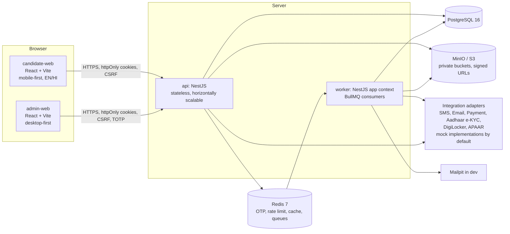
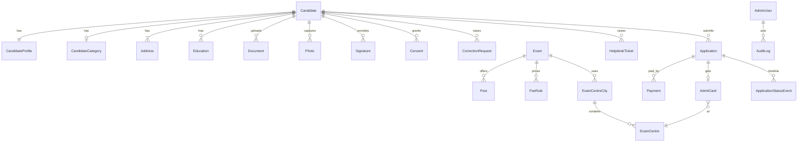

# VTL OTR: Implementation Plan

Product: **VTL OTR** (VTL One Time Registration Platform), a product of Vensysco Technologies Limited.
Source brief: [`docs/BRIEF.md`](./BRIEF.md). Assumptions: [`docs/ASSUMPTIONS.md`](./ASSUMPTIONS.md).

Status: **approved ("cover up all the gaps and go ahead", "make all at once") and implemented**. All six phases were delivered in one pass; see the README for how to run and test, and ASSUMPTIONS.md for the decisions taken along the way. Note: the data model below is the planning view; the implemented schema stores addresses as encrypted JSON on the profile and photo/signature as `MediaAsset` rows (see ARCHITECTURE.md).

---

## 1. Architecture at a glance



Key principles:

- **One source of truth for rules.** Zod schemas, eligibility, age relaxation, fee calculation, OTR ID check digit and photo spec live in `packages/shared` as pure, tested functions. The UI uses them for instant feedback; the API re-runs them and is authoritative.
- **API is stateless.** Sessions are JWTs in cookies with refresh-token rotation tracked in Postgres/Redis. Any number of API replicas can sit behind a load balancer.
- **Slow work is queued.** SMS, email, PDF generation, bulk communication, exports, reconciliation and admit-card generation run in a separate `worker` process via BullMQ, so peak-hour registration traffic is not blocked by I/O.
- **Every integration is an adapter** (`interface` + `Mock*` + real stub) selected by env, so the system runs end to end with no external credentials.

---

## 2. Repository layout

```
VTL-OTR/
├─ apps/
│  ├─ api/                         NestJS API + worker entrypoint
│  │  ├─ prisma/
│  │  │  ├─ schema.prisma
│  │  │  ├─ migrations/
│  │  │  └─ seed/                  exams, masters, admin users, 50 candidates + photos
│  │  ├─ src/
│  │  │  ├─ main.ts                HTTP entrypoint
│  │  │  ├─ worker.ts              BullMQ worker entrypoint
│  │  │  ├─ config/                typed env config (Zod-validated)
│  │  │  ├─ common/                guards, interceptors, filters, decorators, pipes
│  │  │  ├─ security/              crypto (field encryption, blind index), CSRF, helmet/CSP
│  │  │  ├─ integrations/          sms/, email/, payment/, ekyc/, digilocker/, apaar/, captcha/, storage/
│  │  │  └─ modules/
│  │  │     ├─ health/  auth/  otp/  captcha/  consent/
│  │  │     ├─ candidates/  profile/  media/  documents/  otr/
│  │  │     ├─ corrections/  exams/  eligibility/  applications/
│  │  │     ├─ payments/  admit-cards/  results/  notifications/
│  │  │     ├─ helpdesk/  masters/  pdf/  reports/  audit/
│  │  │     └─ admin/ (admin-auth, admin-users, dashboard, verification, comms)
│  │  ├─ templates/                PDF (HTML) + email + SMS templates, EN/HI
│  │  └─ test/                     integration tests (supertest against real PG/Redis)
│  ├─ candidate-web/
│  │  ├─ public/                   favicon, manifest, self-hosted MediaPipe wasm + model
│  │  ├─ src/
│  │  │  ├─ locales/en/*.json, locales/hi/*.json
│  │  │  ├─ routes/                landing, auth, register, wizard/*, dashboard, exams,
│  │  │  │                         applications, payments, admit-card, helpdesk, styleguide
│  │  │  ├─ features/              feature-scoped hooks/components
│  │  │  └─ lib/                   api client, query client, i18n, auth context
│  │  └─ e2e/                      Playwright specs + fake face video fixture
│  └─ admin-web/
│     └─ src/ routes/ (dashboard, exams, candidates, verification, corrections,
│                     payments, admit-cards, comms, reports, audit, masters, users)
├─ packages/
│  ├─ shared/                      types, Zod schemas, enums, pure business rules
│  │  └─ src/ schemas/ rules/eligibility.ts rules/fees.ts rules/age.ts
│  │           otr-id.ts (Verhoeff) photo-spec.ts masking.ts
│  ├─ ui/                          VTL design system (Tailwind preset + shadcn/ui themed)
│  │  └─ src/ tokens.css tailwind-preset.ts components/ (Button, Input, Select, Card,
│  │           Stepper, Alert, Badge, DataTable, FileDrop, OtpInput, SignaturePad,
│  │           LivePhotoCapture/, Logo, AppShell, SkipLink, ...)
│  │           lib/image/ (crop, resize, jpeg-compress-to-range, strip overlay,
│  │                       luminance, laplacian-variance)
│  ├─ eslint-config/  tsconfig/
├─ brand/                          vtl-logo.png + derived assets (white variant, favicon mark)
├─ docker/                         Dockerfiles, nginx config, minio bootstrap
├─ docs/                           PLAN, ASSUMPTIONS, ARCHITECTURE, API, BRIEF
├─ docker-compose.yml
├─ pnpm-workspace.yaml  package.json  .env.example  .github/workflows/ci.yml
```

---

## 3. Tech decisions (beyond what the brief fixes)

| Area | Choice | Why |
|---|---|---|
| Task runner | pnpm workspaces + Turborepo | Cached builds/tests across 5 packages |
| Test runner | Vitest everywhere (API via SWC), Playwright for E2E | One runner, fast, ESM-friendly |
| Validation in Nest | `nestjs-zod` pipe using schemas from `packages/shared` | No duplicate DTO classes |
| OpenAPI | `@nestjs/swagger` fed by Zod schemas, served at `/api/docs` (disabled in prod by default) | Brief deliverable |
| Password hashing | `argon2id` (memory 64 MB, t=3) | Brief |
| PII encryption at rest | App-level AES-256-GCM envelope encryption via a `KeyProvider` adapter (env key in dev, KMS/HSM in prod) + HMAC-SHA256 **blind indexes** for exact-match lookup (mobile, email, Aadhaar ref) | Searchable without storing plaintext |
| Captcha | Self-hosted SVG text captcha stored in Redis, behind a `CaptchaProvider` adapter | No third-party data transfer (gov context); swappable |
| Face checks | MediaPipe tasks-vision **FaceLandmarker** (numFaces=2, blendshapes on), self-hosted wasm + model | One model gives face count, box, blink (eyeBlink blendshapes) and head yaw for liveness |
| Client image processing | Canvas + `OffscreenCanvas` where available, binary search on JPEG quality, downscale fallback | Hit 20 to 50 KB deterministically |
| Server image validation | `file-type` (magic bytes) + `sharp` (decode, dimension check, re-encode to strip EXIF/ICC) | Never trust client |
| PDFs | Handlebars HTML templates rendered by headless Chromium (Playwright) in the worker, pooled browser, output cached in MinIO | Correct Devanagari shaping with Noto fonts, which PDFKit-style libs get wrong |
| QR on admit card | `qrcode` lib; payload is a compact Ed25519-signed token (exam, roll no, OTR ID, hash of photo) verified at `/verify/admit/:token` and in admin | Tamper-evident, offline-verifiable with public key |
| TOTP | `otplib`, secrets encrypted at rest, recovery codes | Brief |
| Logging | `pino` JSON with a redaction list (mobile, email, name, aadhaar, dob, address, tokens) + request IDs | No PII in logs |
| Charts (admin) | Recharts | Lightweight, themeable to VTL tokens |
| Exports | `exceljs` (streaming) + CSV streams, generated in worker, signed download link | Large exports without blocking API |

---

## 4. Data model

All tables have `id` (UUID v7), `createdAt`, `updatedAt`. Fields marked 🔒 are encrypted at rest; fields marked 🔎 have a blind-index column for lookup.

### 4.1 Identity and auth

- **Candidate**: `otrId` (unique, null until final submission), `status` (DRAFT, SUBMITTED, BLOCKED), `mobile`🔒🔎, `email`🔒🔎, `mobileVerifiedAt`, `emailVerifiedAt`, `passwordHash`, `failedLoginCount`, `lockedUntil`, `preferredLanguage`, `submittedAt`, `profileLockedAt`, `dedupeKey` (HMAC of normalised name + DOB + father's name).
- **RefreshToken**: `subjectType` (CANDIDATE/ADMIN), `subjectId`, `familyId`, `tokenHash`, `expiresAt`, `revokedAt`, `userAgent`, `ip`.
- **OtpChallenge** (Redis primarily, Postgres for audit): purpose (REGISTER, LOGIN, FORGOT, CONTACT_CHANGE), channel, target hash, attempts.
- **Consent**: `candidateId`, `purposeCode`, `noticeVersion`, `language`, `grantedAt`, `withdrawnAt`, `ip`, `userAgent`.
- **AdminUser**: `name`, `email`🔎, `passwordHash`, `roles[]` (SUPER_ADMIN, EXAM_ADMIN, VERIFIER, HELPDESK_AGENT, AUDITOR), `totpSecret`🔒, `totpEnrolledAt`, `recoveryCodes` (hashed), `isActive`, lockout fields.

### 4.2 Profile (one row per candidate, versioned through the audit log)

- **CandidateProfile**: names🔒 (`fullName` as per class 10, `fatherName`, `motherName`), `dob`🔒, `gender`, `nationality`, `maritalStatus`, `identificationMarks`🔒, `wizardStep`, `completion` (0 to 100), `aadhaarRefToken` + `aadhaarMasked` (`XXXX-XXXX-1234`), `apaarId`🔒, `digilockerLinkedAt`.
- **CandidateCategory**: `category` (GEN, EWS, OBC_NCL, SC, ST), `pwd` (bool), `pwdType`, `pwdPercent`, `exServiceman`, `serviceYears`, `domicileStateId`, links to certificate Documents.
- **Address** x2 (`type` PERMANENT / CORRESPONDENCE): line1🔒, line2🔒, `stateId`, `districtId`, `city`, `pin`.
- **Education** (many): `level` (CLASS_10, CLASS_12, DIPLOMA, GRADUATION, PG, OTHER), `qualificationId`, `boardId` / `universityId`, `yearOfPassing`, `resultType` (PERCENT, CGPA), `marks`, `maxMarks`/`cgpaScale`, `rollNo`🔒, `status` (PASSED, APPEARING), `documentId`.
- **Document**: `candidateId`, `kind` (CATEGORY_CERT, PWD_CERT, EDU_10, EDU_12, ..., CORRECTION_PROOF, HELPDESK_ATTACHMENT), `objectKey`, `mime`, `sizeBytes`, `sha256`, `source` (UPLOAD, DIGILOCKER), `verificationStatus` (PENDING, APPROVED, REJECTED), `verifiedBy`, `rejectionReason`.
- **Photo**: `candidateId`, `objectKey`, `sha256` (indexed), `width`, `height`, `sizeBytes`, `capturedAt`, `userAgent`, `livenessPassed`, `livenessMethod` (BLINK, HEAD_TURN), `faceScores` (JSON: confidence, centring, area ratio, luminance, blur variance), `attemptNo`, `isCurrent`, `duplicateFlag`.
- **PhotoAttempt**: every capture attempt (accepted or retaken) with scores, for audit and retake limits.
- **Signature**: same shape as Photo plus `method` (DRAWN, UPLOADED).
- **DuplicateFlag**: `type` (PHOTO_HASH, IDENTITY), `candidateIds[]`, `status` (OPEN, CLEARED, CONFIRMED), `reviewedBy`, `notes`.

### 4.3 Corrections and audit

- **CorrectionRequest**: `candidateId`, `field` (NAME, DOB, PHOTO, CATEGORY, ...), `currentValue`🔒, `requestedValue`🔒, `reason`, `documentId`, `status` (PENDING, APPROVED, REJECTED), `decidedBy`, `decisionReason`, `decidedAt`.
- **AuditLog** (append-only, enforced by a DB trigger rejecting UPDATE/DELETE): `actorType`, `actorId`, `action`, `entity`, `entityId`, `before`🔒, `after`🔒, `ip`, `userAgent`, `requestId`, `at`. Partitioned by month for volume.

### 4.4 Exams and applications

- **Exam**: `code`, `title` (EN/HI), `notificationNo`, `body` (conducting body), `status` (DRAFT, PUBLISHED, CLOSED, ARCHIVED), `dates` (JSON: notification, applyStart, applyEnd, feeLastDate, correctionWindow, admitCardRelease, examDate, resultDate), `ageCutoffDate`, `photoSpec` (JSON overrides), `otrIdNotRequired=false`, `customFields` (JSON schema for exam-specific fields), `rollNoFormat`.
- **Post**: `examId`, `code`, `title`, `vacancies` (JSON by category), `eligibility` (JSON rule set, see 6.1).
- **FeeRule**: `examId`, `priority`, `conditions` (category[], gender[], pwd, exServiceman, domicile), `amount`, `currency`.
- **ExamCentreCity**: `examId`, `cityName`, `stateId`, `capacity`, `allocated`.
- **ExamCentre**: `examCentreCityId`, `name`, `address`, `capacity`, `reportingTime`, `gateClosingTime`.
- **Application**: `applicationNo`, `candidateId`, `examId`, `postPreferences` (ordered), `centreCityPreferences` (ordered, up to N), `customFieldValues` (JSON, validated against exam schema), `eligibilitySnapshot` (inputs + result, frozen at submission), `profileSnapshot` (frozen copy of OTR data used, including photo/signature keys), `feeAmount`, `status` (DRAFT, SUBMITTED, PAYMENT_PENDING, PAID, FEE_EXEMPT, REJECTED, WITHDRAWN), `submittedAt`. Unique (`candidateId`, `examId`).
- **ApplicationStatusEvent**: timeline rows (status, at, note).
- **Payment**: `applicationId`, `merchantTxnId` (unique), `gateway`, `gatewayTxnId` (unique when set), `amount`, `status` (INITIATED, PENDING, SUCCESS, FAILED, REFUND_MARKED), `rawCallback` (JSON, sanitised), `reconciledAt`, `reconciliationStatus`, `manualVerifiedBy`.
- **PaymentEvent**: every callback/webhook/recon response with an idempotency key.
- **AdmitCard**: `applicationId`, `rollNo` (unique per exam), `examCentreId`, `allocationMethod` (AUTO, MANUAL), `qrToken`, `pdfObjectKey`, `releasedAt`, `downloadedAt`.
- **Result**: `applicationId`, `status`, `score`, `rank`, `publishedAt` (minimal; full result processing is out of scope).

### 4.5 Support and comms

- **HelpdeskTicket**: `ticketNo`, `candidateId` (nullable for pre-login), `category`, `subject`, `status` (OPEN, IN_PROGRESS, RESOLVED, CLOSED), `assignedTo`; **TicketMessage** with optional attachment Document.
- **Notification**: in-app notifications per candidate.
- **MessageTemplate**: `code`, `channel`, `language`, `subject`, `body`, DLT template id (SMS).
- **BulkCampaign**: filters (JSON), template, counts, status.
- **OutboundMessage**: channel, template, status, attempts, provider ref (target stored hashed only).

### 4.6 Masters and settings

- **State**, **District**, **Board**, **University**, **Qualification** (with level ordering), **CategoryMaster** (code, label EN/HI, default age relaxation), **PwdType**.
- **SystemSetting**: key/value JSON (OTR ID format, retake limit, photo spec defaults, data retention days, OTP limits, feature flags).
- **Sequence**: Postgres sequences for OTR ID, application no, ticket no.

Condensed ER view (the full Mermaid ERD goes into `docs/ARCHITECTURE.md` in phase 1):



Indexes: blind indexes (mobile, email), `otrId`, `dedupeKey`, `Photo.sha256`, `Application(examId,status)`, `Payment(status,createdAt)`, `AuditLog(entity,entityId,at)`, trigram index on a normalised (non-PII) search token for admin name search, all list endpoints keyset-paginated.

---

## 5. Live photo capture design (`packages/ui/LivePhotoCapture`)

State machine (implemented with a reducer, fully unit-testable):

```
intro (explainer) → requesting → [error states] | streaming
streaming → checking (per-frame: face count, centring, size, luminance, blur)
checking --all green for ~700 ms--> liveness (blink OR small head turn, random choice)
liveness --passed--> countdown 3-2-1 → capture → processing → review
review → retake (if attempts < limit) | accept → upload → done
```

- Error states: `PERMISSION_DENIED` (browser-specific instructions for Chrome, Edge, Firefox, Safari iOS/macOS, Android Chrome), `NO_CAMERA`, `CAMERA_IN_USE` (NotReadableError), `INSECURE_CONTEXT`, `UNSUPPORTED`, `MODEL_LOAD_FAILED`.
- Camera switching via `enumerateDevices`; front camera default; tracks stopped on unmount, route change, `visibilitychange` (hidden) and after capture.
- Frame analysis runs on a throttled loop (about 8 to 10 fps) with a downscaled canvas for luminance and Laplacian variance, so it is smooth on low-end Android.
- Output pipeline (pure functions in `packages/ui/lib/image`, unit tested in Node with `@napi-rs/canvas`): un-mirror → crop 3.5:4.5 around face box with headroom → resize 350x450 → optional name/date strip → JPEG binary search on quality (0.92 down to 0.4) then downscale step if still too big, ensuring 20 to 50 KB → blob + metadata.
- Live-capture-only rule: no `<input type=file>` anywhere in the photo path; API rejects photos lacking a capture session token issued when the camera stream started (short-lived, single use, bound to candidate) and the attempt metadata. This is not cryptographic proof of a camera, but it removes the casual "upload a file" path and is logged for audit.
- Signature: `SignaturePad` (pointer events, smoothing) or scanned upload; auto-trim whitespace, fit to 140x60, compress to 10 to 20 KB.

---

## 6. Business rules (in `packages/shared`, unit tested)

### 6.1 Eligibility
Rule set per post:
```ts
{ age: { min: 18, max: 27, cutoffDate: '2026-08-01',
         relaxation: { OBC_NCL: 3, SC: 5, ST: 5, PWD: 10, PWD_OBC: 13, PWD_SC_ST: 15,
                       EX_SERVICEMAN: 'serviceYears+3' } },
  qualification: { minLevel: 'GRADUATION', minPercent?: 55, minPercentReserved?: 50,
                   allowAppearing: true, specific?: [qualificationIds] },
  domicile?: { states: [...], mode: 'REQUIRED' | 'RELAXATION_ONLY' },
  gender?: ['F'], nationality: ['INDIAN'] }
```
Output is a structured result (`eligible`, per-criterion pass/fail with human-readable reasons in EN/HI) so the UI can explain "why not".
Age is computed in completed years/months/days on the cutoff date (Indian recruitment convention, born on or after / on or before boundaries are inclusive).

### 6.2 Fees
First matching `FeeRule` by priority; default seed matrix: GEN/OBC/EWS male 100, female/SC/ST/PwD/ex-serviceman exempt (0). Exempt applications skip payment and go to `FEE_EXEMPT`.

### 6.3 OTR ID
Template `{PREFIX}-{YEAR}-{SEQ}{CHECK}` with `PREFIX=VTL-OTR`, `SEQ` zero-padded 7 digits from a Postgres sequence, `CHECK` = Verhoeff digit over `YEAR+SEQ`. Example: `VTL-OTR-2026-00001236`. Format configurable in `SystemSetting`; validator exported for client-side typo detection.

---

## 7. API surface (`/api/v1`, JSON, cookie auth, CSRF header on mutating requests)

**Public / health**
- `GET /health/live`, `GET /health/ready`
- `GET /public/exams` (published notifications), `GET /public/exams/:code`, `GET /public/faqs`, `GET /public/masters/:type`
- `GET /captcha` → `{id, svg}`
- `GET /verify/admit/:token` (QR verification)

**Candidate auth**
- `POST /auth/register/start` (name, dob, gender, mobile, email, captcha, consent) → sends both OTPs
- `POST /auth/register/verify` (mobile OTP, email OTP) → `POST /auth/register/password`
- `POST /auth/login` (OTR ID / mobile / email + password + captcha), `POST /auth/login/otp/request`, `POST /auth/login/otp/verify`
- `POST /auth/refresh`, `POST /auth/logout`, `GET /auth/me`, `GET /auth/csrf`
- `POST /auth/forgot/otr-id`, `POST /auth/forgot/password/request`, `POST /auth/forgot/password/reset`

**Profile and media**
- `GET /me/profile`, `PUT /me/profile/personal`, `PUT /me/profile/category`, `PUT /me/profile/address`, `PUT /me/profile/education`, `PUT /me/profile/declaration` (each auto-saves partial drafts; strict validation only on "continue" and final submit)
- `POST /me/documents` (multipart PDF/JPEG, size limits), `GET /me/documents/:id/url` (signed URL), `DELETE /me/documents/:id` (only before submission)
- `POST /me/photo/session` → capture session token; `POST /me/photo` (JPEG + metadata); `POST /me/photo/attempts` (log retake); `GET /me/photo/url`
- `POST /me/signature`, `GET /me/signature/url`
- `POST /me/identity/aadhaar/initiate|verify`, `POST /me/identity/digilocker/connect`, `GET /me/identity/digilocker/callback`, `POST /me/identity/apaar`
- `GET /me/preview`, `POST /me/submit` → OTR ID; `GET /me/otr-slip.pdf`
- `POST /me/contact/change/request`, `POST /me/contact/change/verify` (address/email with OTP)
- `GET|POST /me/corrections`
- `GET /me/notifications`, `POST /me/notifications/:id/read`

**Exams, applications, payments**
- `GET /exams` (open, with eligibility evaluated for me), `GET /exams/:id`, `GET /exams/:id/eligibility`
- `POST /applications` (draft), `PUT /applications/:id`, `POST /applications/:id/submit`, `GET /applications`, `GET /applications/:id`, `GET /applications/:id/form.pdf`
- `POST /applications/:id/payments` → redirect payload; `POST /payments/callback/:gateway` (signature-verified, idempotent); `GET /payments/:id`, `GET /payments/:id/receipt.pdf`
- Mock gateway UI: `GET /mock-gateway/pay/:merchantTxnId` with Success / Failure / Pending buttons (dev only)
- `GET /applications/:id/admit-card.pdf`, `GET /applications/:id/result`

**Helpdesk**
- `POST /helpdesk/tickets` (also pre-login with captcha), `GET /helpdesk/tickets`, `GET /helpdesk/tickets/:id`, `POST /helpdesk/tickets/:id/messages`

**Admin** (`/admin/...`, RBAC per route; every mutation audited)
- Auth: `POST /admin/auth/login`, `POST /admin/auth/totp/enrol`, `POST /admin/auth/totp/verify`, `POST /admin/auth/logout`, `POST /admin/auth/refresh`
- Users: CRUD `/admin/users`, `POST /admin/users/:id/reset-totp`
- Dashboard: `GET /admin/dashboard/summary`, `/funnel`, `/by-exam`, `/by-state`, `/by-category`, `/by-gender`, `/payments`
- Exams: CRUD `/admin/exams`, `/admin/exams/:id/posts`, `/fee-rules`, `/centre-cities`, `/centres`, `/custom-fields`, `POST /admin/exams/:id/publish|unpublish`
- Candidates: `GET /admin/candidates?q=&otrId=&mobile=&email=`, `GET /admin/candidates/:id` (incl. photo metadata), `POST /admin/candidates/:id/block|unblock`
- Verification: `GET /admin/documents?status=PENDING`, `POST /admin/documents/:id/approve|reject`
- Duplicates: `GET /admin/duplicates`, `POST /admin/duplicates/:id/clear|confirm`
- Corrections: `GET /admin/corrections`, `POST /admin/corrections/:id/approve|reject`
- Payments: `GET /admin/payments`, `POST /admin/payments/:id/verify`, `POST /admin/payments/:id/mark-refund`, `POST /admin/payments/reconcile`
- Admit cards: `POST /admin/exams/:id/roll-numbers/allocate`, `POST /admin/exams/:id/centres/allocate`, `PUT /admin/admit-cards/:id/centre` (override), `POST /admin/exams/:id/admit-cards/generate`, `POST /admin/exams/:id/admit-cards/release`
- Comms: CRUD `/admin/templates`, `POST /admin/campaigns` (filters + template, preview count), `GET /admin/campaigns`
- Reports: `POST /admin/reports/:type` (applicants, category-wise, payments, ...) → job; `GET /admin/reports/jobs/:id` → signed download URL
- Audit: `GET /admin/audit-logs?actor=&entity=&from=&to=`
- Masters: CRUD `/admin/masters/:type`
- Settings: `GET|PUT /admin/settings` (OTR format, retake limit, photo spec, retention, OTP limits)
- Helpdesk: `GET /admin/tickets`, `POST /admin/tickets/:id/assign|reply|status`

---

## 8. Security and compliance checklist (built in, not bolted on)

- argon2id; login + OTP rate limits in Redis (per IP, per identifier); lockout after 5 failures for 30 min; generic error messages (no user enumeration).
- Access JWT 15 min, refresh 7 days (candidate) / 8 h (admin), rotation with reuse detection that revokes the whole family. Cookies: `HttpOnly; Secure; SameSite=Strict; Path` scoped. CSRF: double-submit token header `X-CSRF-Token`.
- Admin: TOTP mandatory before any admin route; step-up TOTP for sensitive actions (approve correction, refund mark, bulk comms, exports).
- Helmet, strict CSP (`default-src 'self'`; `script-src 'self' 'wasm-unsafe-eval'` for MediaPipe; no inline scripts; `img-src 'self' blob: data:` plus MinIO origin), HSTS, `Permissions-Policy: camera=(self)`.
- Private MinIO buckets; downloads only via short-lived signed URLs after an ownership/role check.
- Field-level encryption + blind indexes; Postgres TDE/disk encryption noted for ops.
- Pino redaction; audit log stores encrypted before/after; no PII in URLs.
- DPDP: consent capture with versioned notice (EN/HI) at registration, purpose statement, consent ledger, retention settings with a purge/anonymise job for abandoned drafts, data access/export request via helpdesk category.
- WCAG 2.1 AA: skip links, landmarks, labels, error summaries with focus management, 4.5:1 contrast checks via axe in Playwright, keyboard-operable camera flow, screen-reader live region for capture guidance.
- GIGW 3.0: bilingual, last-updated date in footer, sitemap, accessibility statement, help, feedback, privacy/terms/copyright/hyperlink policy pages.

---

## 9. Phases and acceptance criteria

Each phase ends with: `pnpm lint && pnpm typecheck && pnpm test` green, app run locally, relevant Playwright specs green, short report to you.

### Phase 1: Foundation, design system, auth/OTP
- Monorepo, tooling (ESLint, Prettier, strict TS, Turborepo, Vitest, Playwright), CI workflow.
- `docker-compose.yml`: postgres, redis, minio (+ bucket bootstrap), mailpit, api, worker, candidate-web, admin-web.
- Brand assets: white-text logo variant, VTL mark favicon/app icons generated from `brand/vtl-logo.png`.
- `packages/ui`: tokens, Tailwind preset, fonts (self-hosted Plus Jakarta Sans, Inter, Noto Sans Devanagari), core components, AppShell header/footer, `/styleguide` route.
- `packages/shared`: base schemas, enums, masking helpers.
- API: config, logging, health, Prisma schema (full model above) + first migration, field encryption, audit interceptor, CSRF, Helmet/CSP, rate limiting, captcha, OTP (Redis), SMS/Email mock adapters (emails visible in Mailpit), candidate register / verify / login / refresh / logout / forgot flows, consent capture.
- Candidate web: landing page (EN/HI), register, OTP verify, set password, login, forgot OTR ID/password.
- Seed: masters (all states/UTs + districts, boards, universities sample, categories), super admin.
- Docs: README, ARCHITECTURE (full ERD), ASSUMPTIONS.
- Tests: unit (schemas, masking, crypto, OTP service), API integration (register → verify → login → refresh), E2E (register with OTP read from mock store).

### Phase 2: Profile wizard, live photo, signature
- Wizard with stepper, auto-save per step (debounced) and resume.
- Personal, category (cert upload), address (same-as toggle, state/district/PIN), education (multiple levels, PDF upload).
- `LivePhotoCapture` complete (all error states, MediaPipe checks, liveness, countdown, review, retake limit, compression), signature pad + upload.
- API media module: validation, EXIF strip, SHA-256, MinIO storage, duplicate-hash flagging, attempt logging.
- Aadhaar e-KYC / DigiLocker / APAAR mock adapters wired into an optional "Verify identity" step.
- Tests: unit (crop/resize/compress, luminance, Laplacian, state machine), API (photo validation edge cases: wrong MIME, PNG renamed, too big/small, wrong dimensions, EXIF present), Playwright camera E2E with fake device + face video.

### Phase 3: OTR submission, ID, PDFs
- Declaration + full preview, final submit, OTR ID generation with Verhoeff check digit, locks on core fields and photo.
- PDF service in worker (Chromium pool), OTR registration slip, SMS + email with OTR ID.
- Post-submission edits: non-core (address, email with OTP), correction requests with documents, full audit trail.
- Candidate dashboard v1 (profile completion, notifications, correction requests).
- Tests: OTR ID generation/validation, lock enforcement, correction flow API, PDF generation smoke test.

### Phase 4: Exams, eligibility, applications, payments
- Exam listing with auto eligibility (and reasons), application form (post and centre-city preferences, custom fields), fee calculation, application form PDF.
- Payment adapter + mock gateway (success / failure / pending), signed idempotent callbacks, reconciliation repeatable job, receipt PDF.
- Dashboard: application timeline. Helpdesk tickets (candidate side).
- Seed: 3 exams (e.g. a graduate-level CGL-style exam, a class-12 clerical exam, a women-only/state-domicile exam) with posts, rules, fee matrix, centres.
- Tests: eligibility + age relaxation + fee matrix table-driven unit tests, payment idempotency and state machine integration tests, E2E apply → pay.

### Phase 5: Admin portal
- Admin login with mandatory TOTP enrolment, RBAC, user management.
- Dashboard with charts, exam management (all sub-entities, publish/unpublish), candidate search and full profile view with photo metadata, document verification, duplicate review, block/unblock, correction queue, payments list and manual verification/refund marker, helpdesk agent console, masters CRUD, settings.
- Tests: RBAC matrix integration tests, TOTP, admin E2E smoke.

### Phase 6: Admit cards, reports, audit, hardening
- Roll number allocation, centre allocation (by preference order and capacity, deterministic, manual override), bulk admit-card PDF generation in worker, release, candidate download, signed QR + verification page.
- Bulk SMS/email campaigns with templates and filters; reports and exports (CSV/XLSX) via jobs; audit log viewer; results display (basic).
- Hardening: retention purge job, security headers review, OWASP ZAP baseline scan (if available offline), axe accessibility pass on all candidate pages, Lighthouse mobile performance check (LCP target), k6 load script for registration + OTP endpoints, seed of 50 candidates with photos in various states.
- Full Playwright journey: register → OTP → full profile → live photo → submit → apply → pay → admin releases admit card → candidate downloads admit card.
- Final docs: README, API.md/Swagger, ARCHITECTURE, ASSUMPTIONS.

---

## 10. Things I need from you (defaults chosen so I can proceed if you only say "go")

1. **Logo resolution.** `brand/vtl-logo.png` is 497x123 px (taken from the image you attached). It is fine on screen but soft on printed admit cards. If you have an SVG or a 2000 px+ PNG, please add it. Default: use this file, and generate the white-text variant and favicon from it.
2. **Face video for the camera E2E test.** Chromium's fake camera needs a `.y4m` clip of a real face that blinks. Default: I will build one from a CC0 / synthetic face source. If you can provide a 5 second consenting clip (head and shoulders, one blink, plain background), the test will be more realistic.
3. **OTR ID width.** Default 7-digit sequence + 1 check digit (`VTL-OTR-2026-00001236`), giving 10 million IDs per year. Your example used 7 digits total; tell me if you want the shorter form.
4. **Candidate login.** Default: password login (OTR ID, mobile or email) plus an OTP-only login option. Say if you want OTP-only.

Reply "approved" (optionally with answers above) and I will start Phase 1.
